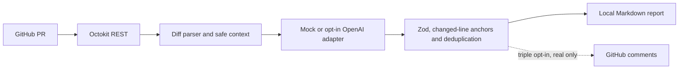

<div align="center">

# AI Pull Request Reviewer 🤖

**Revisiones de PR seguras, comentarios útiles y decisiones humanas.**

[🇺🇸 English](README.md) · [🇧🇷 Português](README.pt-BR.md) · [🇪🇸 Español](README.es.md)

[](https://github.com/RamonRDR/ai-pull-request-reviewer/actions/workflows/ci.yml)
[](https://nodejs.org/)
[](LICENSE)
[](README.md)

[](https://www.typescriptlang.org/)
[](https://github.com/octokit/rest.js)
[](https://docs.github.com/en/rest)
[](https://zod.dev/)
[](https://github.com/openai/openai-node)

[](src/cli.ts)
[](https://github.com/privatenumber/tsx)
[](.github/workflows/ci.yml)
[](.ai-pr-reviewer.json)

[](https://github.com/RamonRDR/ai-pull-request-reviewer/actions/workflows/ci.yml)
[](eslint.config.mjs)
[](.prettierrc.json)
[](tsconfig.json)
[](.github/workflows/ci.yml)
[](.github/workflows/ci.yml)
[](src/evaluate.ts)

</div>

> **Estado del proyecto:** MVP implementado en el [PR #1](https://github.com/RamonRDR/ai-pull-request-reviewer/pull/1), **abierto para revisión**. La [ejecución de CI comprobada](https://github.com/RamonRDR/ai-pull-request-reviewer/actions/workflows/ci.yml) aprobó **34 pruebas Vitest (0 fallos, 0 omitidas)**, tipado, lint, formato, compilación, demostración, evaluación sintética y auditoría de dependencias de producción. No se ha autorizado la fusión, el uso real de LLM ni la publicación de comentarios.

## 1. Descripción general

Revisor de pull requests de GitHub que prioriza la seguridad y las decisiones humanas. Lee modificaciones, prepara contexto limitado y genera hallazgos técnicos en Markdown. Es una **CLI ejecutada mediante GitHub Actions**, no una GitHub App alojada. Nunca aprueba, rechaza ni fusiona PR automáticamente. **El mock predeterminado simula el proceso con ejemplos sintéticos; no detecta errores reales** ni reemplaza un escáner de seguridad.

## 2. Funciones implementadas

- Consulta metadatos, ramas origen/destino y archivos modificados mediante Octokit y GitHub REST, con paginación y manejo de errores.
- Analiza diffs y ubica líneas agregadas del lado RIGHT; omite parches incompletos, binarios, inaccesibles o demasiado grandes, sin inventar referencias.
- Excluye dependencias, archivos generados, lockfiles, binarios y rutas sensibles; oculta patrones habituales de secretos antes de preparar el contexto.
- Prioriza cambios de código y controla límites de archivos, caracteres, tokens, salida, comentarios y presupuesto estimado en dólares.
- Separa proveedores: mock gratuito y determinista, junto con un **adaptador opcional de OpenAI API aún no validado integralmente**.
- Valida JSON con Zod; descarta categorías no habilitadas, severidades insuficientes, duplicados, datos sensibles y líneas inexistentes.
- Produce informes Markdown con ID, categoría, gravedad, ubicación, evidencia, explicación y corrección sugerida.
- Incluye publicación protegida por **tres autorizaciones simultáneas**, que rechaza mocks, forks y análisis parciales. La publicación real no se ha probado.

## 3. Tecnologías

**Runtime:** Node.js **26 en CI** (`engines.node >=22` en el manifiesto). **Lenguaje:** TypeScript **5.9.3**, modo strict, además de configuración JavaScript. **GitHub:** `@octokit/rest 22.0.1` y API REST. **Esquemas:** Zod **4.6.7**. **IA opcional:** OpenAI SDK **6.49.0**, inactivo sin permiso y presupuesto. **Herramientas:** `tsx 4.23.15`, Vitest **4.1.12**, ESLint **9.39.5**, Prettier **3.9.10**, npm y GitHub Actions. Versiones exactas resueltas en `package-lock.json`; los badges muestran versiones principales.

No hay servidor, bases de datos, Redis, Docker, Python, pytest, E2E de navegador, RAG, embeddings, MCP ni despliegue.

## 4. Arquitectura



El revisor trata los diffs como **datos no confiables** y no ejecuta el código analizado. Más información: [arquitectura](docs/ARCHITECTURE.md), [decisiones técnicas](docs/DECISIONS.md) y [modelo de amenazas](docs/SECURITY.md).

## 5. Requisitos e instalación

Node.js **22 o superior** y npm. CI usa Node.js 26. Para PR reales se necesita token limitado al repositorio con **Contents: read** y **Pull requests: read**. La demo no requiere credenciales ni servicios externos.

```bash
git clone https://github.com/RamonRDR/ai-pull-request-reviewer.git
cd ai-pull-request-reviewer
npm ci
npm run typecheck
npm test
npm run demo
npm run evaluate
```

Se utiliza el lockfile versionado. No incluya claves ni tokens en Git.

## 6. Configuración

Las reglas se definen en [`.ai-pr-reviewer.json`](.ai-pr-reviewer.json) y se validan antes de ejecutar.

| Configuración                        | Finalidad                                                  |
| ------------------------------------ | ---------------------------------------------------------- |
| `categories` / `minSeverity`         | Categorías de revisión y gravedad mínima                   |
| `ignore`                             | Patrones glob adicionales para excluir                     |
| `maxFiles` / `maxContextChars`       | Alcance y límite de caracteres de entrada                  |
| `maxInputTokens` / `maxOutputTokens` | Estimación previa de entrada y límite de salida del modelo |
| `maxCostUsd`                         | Límite estimado del costo en USD por revisión              |
| `maxComments`                        | Cantidad máxima de hallazgos aceptados                     |
| `language` / `customRules`           | Idioma del informe y reglas del repositorio                |
| `enablePublishing`                   | Deshabilitado por defecto; necesita otros permisos         |

Consulte [`.env.example`](.env.example). La CLI **no carga archivos .env automáticamente**; configure las variables en el entorno o un gestor de secretos. El modo predeterminado solo genera informes.

## 7. CLI y uso de GitHub API

```bash
# Metadatos de PR real, solo lectura y con proveedor simulado:
export GITHUB_TOKEN=YOUR_SCOPED_TOKEN
npm run build
node dist/src/cli.js --repo OWNER/REPO --pr 123 --provider mock

# Demo sin conexión (no requiere token, API pagada ni PR real):
npm run demo
# Generado: reports/demo.md
```

El proveedor `mock` consulta metadatos reales, pero solo responde a marcadores sintéticos como `DEMO_BUG` y `DEMO_EDGE`. Un resultado sin hallazgos **no certifica que el PR sea correcto**.

## 8. LLM externo opcional y presupuesto

**Opcional y con costo:** utilice `--provider openai --allow-external-llm`. Compruebe las tarifas actuales, configure precios positivos por millón de tokens y límites conservadores para `maxInputTokens`, `maxOutputTokens` y `maxCostUsd`.

```bash
export OPENAI_API_KEY=YOUR_KEY
export LLM_MODEL=gpt-4.1-mini
export LLM_INPUT_PRICE_PER_MILLION=YOUR_VERIFIED_INPUT_PRICE
export LLM_OUTPUT_PRICE_PER_MILLION=YOUR_VERIFIED_OUTPUT_PRICE
# Configure también GITHUB_TOKEN; utilice solo repositorios PÚBLICOS.
node dist/src/cli.js --repo OWNER/PUBLIC_REPO --pr 123 --provider openai --allow-external-llm
```

La CLI bloquea el uso remoto de modelos con **repositorios privados**. La redacción de secretos es imperfecta, así que no envíe código confidencial. Los costos son estimaciones, nunca garantías de facturación. CI obligatorio **no realiza llamadas pagadas**.

## 9. Hallazgos, categorías y gravedad

Categorías: `bug`, `security`, `edge_case`, `maintainability`, `testing` y `performance`. Gravedades: `critical`, `high`, `medium`, `low` e `informational`. Cada hallazgo apunta a una **línea agregada real**, presenta ID y corrección sugerida, y puede incluir evidencia o confianza sin calibración. No se generan comentarios para rellenar categorías; la verificación final corresponde a una persona.

## 10. Publicación y eliminación de duplicados

Normalmente se genera únicamente un informe Markdown local. Publicar exige `--publish`, `enablePublishing: true` y `ALLOW_GITHUB_COMMENTS=true` **simultáneamente**, además de **Pull requests: write**. El mecanismo impide publicar mocks, forks o revisiones parciales y compara fingerprints con comentarios anteriores. Solo utiliza `COMMENT`; jamás `APPROVE`, `REQUEST_CHANGES` ni merge. **La publicación real permanece deshabilitada y sin validación externa.**

## 11. Pruebas, calidad y GitHub Actions

```bash
npm run lint
npm run format:check
npm run typecheck
npm test
npm run test:integration
npm run evaluate
npm run build
```

El [CI](.github/workflows/ci.yml) ejecuta `npm ci`, ESLint, Prettier, TypeScript strict, Vitest, evaluación sintética, compilación, artefacto de demostración y auditoría de dependencias de producción en runners alojados de GitHub. El [workflow manual de solo lectura](.github/workflows/demo.yml) admite un número opcional de PR y no publica comentarios. Sin runners propios, despliegue ni uso de IA pagada.

**Ejecución de referencia verificada:** [34 aprobadas, 0 fallidas, 0 omitidas](https://github.com/RamonRDR/ai-pull-request-reviewer/actions/workflows/ci.yml). El badge presenta la **cantidad real comprobada**, no el número de archivos. CI compara los tres badges README con el informe JSON de Vitest; si cambia el número de pruebas, deben actualizarse los tres antes de superar el check. No se afirma cobertura porcentual porque no se mide.

## 12. Evaluación

`npm run evaluate` ejecuta **27 casos sintéticos**: 18 marcadores en seis categorías, 7 cambios correctos y 2 textos de prompt injection. Las métricas de precisión, recall, falsos positivos, duplicados, localización, tokens y costos son **solo del mock**. **No demuestran la capacidad de OpenAI para detectar vulnerabilidades reales.** No hay evaluación del modelo real.

## 13. Seguridad

Consulte [SECURITY.md](docs/SECURITY.md). Los controles incluyen permisos de lectura en CI, exclusión de rutas confidenciales, ocultación parcial de secretos, límites de costo, aislamiento de diffs no confiables, validación Zod, comprobación de líneas, bloqueo de forks y autorización triple. El revisor no hace checkout ni ejecuta código de PR de terceros y no usa `pull_request_target`. Prompt injection, secretos inusuales y alucinaciones continúan siendo riesgos.

## 14. Demostración reproducible

Ejecute `npm run demo` para obtener `reports/demo.md`, identificado como **SIMULATED DEMO ONLY**. La muestra `src/average.ts` contiene marcadores artificiales de lógica y entradas vacías; `src/greeting.ts` es un cambio correcto que no debe generar hallazgos. Consulte la [guía de demostración](docs/DEMO.md) y el [informe ilustrativo](examples/review.sample.md). CI adjunta el informe generado. No se atribuyen capturas, vídeos o revisiones reales inexistentes.

## 15. Estructura del repositorio

| Ruta                                             | Responsabilidad                                                 |
| ------------------------------------------------ | --------------------------------------------------------------- |
| `src/github.ts` / `src/diff.ts`                  | Octokit REST, paginación y análisis de líneas modificadas       |
| `src/context.ts` / `src/config.ts`               | Filtros, redacción de secretos, límites y reglas validadas      |
| `src/provider.ts`                                | Mock determinista y adaptador opcional OpenAI                   |
| `src/models.ts` / `src/review.ts`                | Esquemas, gravedad, ubicación y eliminación de duplicados       |
| `src/report.ts` / `src/publish.ts`               | Informe Markdown y comentarios protegidos                       |
| `src/cli.ts` / `src/demo.ts` / `src/evaluate.ts` | Comandos, demo local y evaluación sintética                     |
| `tests/`                                         | Pruebas unitarias y de integración simuladas con Vitest         |
| `.github/workflows/ci.yml`                       | Calidad, evaluación, compilación, auditoría y artefacto de demo |
| `.github/workflows/demo.yml`                     | Revisión manual de solo lectura                                 |
| `docs/` / `examples/`                            | Arquitectura, ADR, seguridad, demo y ejemplos                   |

## 16. Limitaciones conocidas

- Sin análisis semántico integral entre archivos, ejecución del código revisado, precisión verificada de LLM ni GitHub App instalado en producción.
- Los parches ausentes, binarios o extensos reducen cobertura; se informa de análisis parciales.
- El modelo puede inventar u omitir defectos pese a validaciones de esquema y ubicación.
- Las defensas ante prompt injection, la redacción de secretos y las estimaciones de costo **no son garantías**.
- Las llamadas a LLM real y la publicación en PR reales todavía no tienen autorización ni pruebas integrales.
- No se publican paquetes npm ni se despliegan servicios.

## 17. Contribución y mantenimiento

Abra una issue antes de cambios extensos; envíe pull requests pequeños con pruebas y documentación en inglés. Mantenga sincronizadas las traducciones al portugués y español. Ejecute `npm run check` antes de un merge. Los badges deben coincidir con la última ejecución exitosa de Vitest y el script `scripts/check-test-badges.mjs` comprueba esa consistencia. Todas las aprobaciones y fusiones siguen siendo humanas.

## 18. Licencia

[MIT](LICENSE) © 2026 Ramon Rodriguez. Conserve avisos de terceros.
