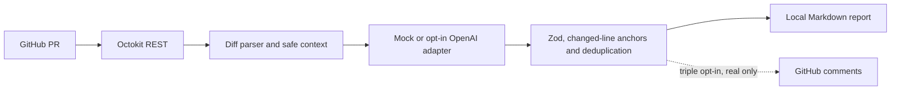

<div align="center">

# AI Pull Request Reviewer 🤖

**Security-first PR reviews, actionable feedback, human-controlled decisions.**

[🇺🇸 English](README.md) · [🇧🇷 Português](README.pt-BR.md) · [🇪🇸 Español](README.es.md)

[](https://github.com/RamonRDR/ai-pull-request-reviewer/actions/workflows/ci.yml)
[](https://nodejs.org/)
[](LICENSE)
[](README.md)

[](https://www.typescriptlang.org/)
[](https://github.com/octokit/rest.js)
[](https://docs.github.com/en/rest)
[](https://zod.dev/)
[](https://github.com/openai/openai-node)

[](src/cli.ts)
[](https://github.com/privatenumber/tsx)
[](.github/workflows/ci.yml)
[](.ai-pr-reviewer.json)

[](https://github.com/RamonRDR/ai-pull-request-reviewer/actions/workflows/ci.yml)
[](eslint.config.mjs)
[](.prettierrc.json)
[](tsconfig.json)
[](.github/workflows/ci.yml)
[](.github/workflows/ci.yml)
[](src/evaluate.ts)

</div>

> **Project status:** MVP implemented in [PR #1](https://github.com/RamonRDR/ai-pull-request-reviewer/pull/1), which is **open for review**. The [verified CI run](https://github.com/RamonRDR/ai-pull-request-reviewer/actions/workflows/ci.yml) passed **34 Vitest tests (0 failures, 0 skips)**, TypeScript, lint, formatting, build, the offline demo, mock evaluation and production dependency audit. No merge, live LLM analysis or real PR publication has been authorized.

## 1. Overview

A security-first, human-in-the-loop reviewer for GitHub pull requests. It reads changed files and diffs, prepares bounded context and produces actionable Markdown findings. It is a **CLI executed in GitHub Actions**, not a hosted GitHub App. It does not automatically approve, reject or merge pull requests. **The default mock is a synthetic demonstration, not actual AI detection** or a production security scanner.

## 2. Implemented features

- Fetch PR metadata, base/head branches and changed files using Octokit and the GitHub REST API, with pagination and error reporting.
- Parse unified diffs and map findings to added RIGHT-side lines; skip incomplete, binary, unavailable or oversized patches rather than inventing line anchors.
- Filter vendor, build, generated, binary, lock and sensitive paths; redact common secret formats before preparing model context.
- Prioritize changed source files and enforce file, character, token, output, comment and estimated USD budget limits.
- Keep providers isolated: deterministic zero-cost mock and an **optional, not end-to-end validated OpenAI API adapter**.
- Validate JSON output with Zod; filter unsupported categories, severities, duplicate comments, unsafe output and nonexistent line anchors.
- Produce Markdown reports with finding IDs, categories, severity, location, evidence, explanation and suggested fix.
- Provide guarded publication code, requiring **three simultaneous operator opt-ins** and rejecting mock, fork and partial results. Publication to a real PR remains untested.

## 3. Technology stack

**Runtime:** Node.js **26 in CI** (`engines.node >=22` in the manifest). **Language:** TypeScript **5.9.3**, strict mode, plus minimal JavaScript tooling. **GitHub integration:** `@octokit/rest 22.0.1` and REST. **Schemas:** Zod **4.6.7**. **Optional model adapter:** OpenAI SDK **6.49.0**; disabled unless explicitly enabled and budgeted. **Developer tooling:** `tsx 4.23.15`, Vitest **4.1.12**, ESLint **9.39.5**, Prettier **3.9.10**, npm and GitHub Actions. Versions here are resolved in `package-lock.json`; major versions are shown on badges for readability.

No server, database, Redis, Docker, Python, pytest, browser E2E framework, RAG, embeddings, MCP or deployment pipeline is implemented.

## 4. Architecture



The tool treats PR patch text as **untrusted data** and does not execute reviewed PR code. See [architecture](docs/ARCHITECTURE.md), [technical decisions](docs/DECISIONS.md) and [threat model](docs/SECURITY.md).

## 5. Requirements and installation

Node.js **22 or newer** and npm; Node.js 26 is used by CI. For a live PR, use a GitHub token scoped to the repository with **Contents: read** and **Pull requests: read** permissions. The offline demo needs no token or remote service.

```bash
git clone https://github.com/RamonRDR/ai-pull-request-reviewer.git
cd ai-pull-request-reviewer
npm ci
npm run typecheck
npm test
npm run demo
npm run evaluate
```

The installation uses the committed npm lockfile. Do not commit local API keys or tokens.

## 6. Configuration

Versioned configuration lives in [`.ai-pr-reviewer.json`](.ai-pr-reviewer.json) and is validated before execution.

| Setting                              | Purpose                                           |
| ------------------------------------ | ------------------------------------------------- |
| `categories` / `minSeverity`         | Review categories and minimum severity            |
| `ignore`                             | Additional glob patterns to exclude               |
| `maxFiles` / `maxContextChars`       | Scope and input character limit                   |
| `maxInputTokens` / `maxOutputTokens` | Preflight input estimate and model output ceiling |
| `maxCostUsd`                         | Estimated USD cost ceiling per review             |
| `maxComments`                        | Maximum accepted findings                         |
| `language` / `customRules`           | Report language and repository rules              |
| `enablePublishing`                   | Disabled by default; additional opt-in required   |

See [`.env.example`](.env.example). The CLI **does not automatically load a .env file**: set variables in your environment or secrets manager. The default remains report-only.

## 7. CLI and GitHub API usage

```bash
# Read-only live PR metadata with a synthetic-only provider:
export GITHUB_TOKEN=YOUR_SCOPED_TOKEN
npm run build
node dist/src/cli.js --repo OWNER/REPO --pr 123 --provider mock

# Offline sample (no token, paid API, or real PR needed):
npm run demo
# Generated: reports/demo.md
```

The live `mock` mode retrieves actual PR metadata but intentionally responds only to synthetic markers such as `DEMO_BUG` and `DEMO_EDGE`. An empty result is **not evidence of a clean PR**.

## 8. Optional external LLM and cost controls

**Optional and paid:** explicitly request the OpenAI adapter with `--provider openai --allow-external-llm`. Verify prices with the provider, set positive per-million-token rates and keep conservative `maxInputTokens`, `maxOutputTokens` and `maxCostUsd` values.

```bash
export OPENAI_API_KEY=YOUR_KEY
export LLM_MODEL=gpt-4.1-mini
export LLM_INPUT_PRICE_PER_MILLION=YOUR_VERIFIED_INPUT_PRICE
export LLM_OUTPUT_PRICE_PER_MILLION=YOUR_VERIFIED_OUTPUT_PRICE
# GITHUB_TOKEN must also be set; use PUBLIC repository code only.
node dist/src/cli.js --repo OWNER/PUBLIC_REPO --pr 123 --provider openai --allow-external-llm
```

The CLI blocks remote LLM use on **private repositories**. Secret redaction is best effort, so never send confidential or secret-bearing code. Provider costs are estimates, not billing guarantees. Mandatory CI makes **no paid model calls**.

## 9. Findings, categories and severity

Categories: `bug`, `security`, `edge_case`, `maintainability`, `testing` and `performance`. Severities: `critical`, `high`, `medium`, `low`, `informational`. A finding references an **existing added line**, includes an ID and suggested correction, and may carry uncalibrated confidence or evidence. The reviewer does not manufacture comments to fill categories; AI suggestions always require human verification.

## 10. Publication and duplicate prevention

By default, only a local Markdown report is produced. Real review comments require `--publish`, `enablePublishing: true` and `ALLOW_GITHUB_COMMENTS=true` **together**, plus **Pull requests: write** permission. The publish path rejects simulated output, PRs from forks and partial reviews; it compares stable fingerprints against existing review comments. It uses `COMMENT` only, never `APPROVE`, `REQUEST_CHANGES` or merge. **Live publication has not been enabled or independently verified.**

## 11. Tests, quality and GitHub Actions

```bash
npm run lint
npm run format:check
npm run typecheck
npm test
npm run test:integration
npm run evaluate
npm run build
```

[CI](.github/workflows/ci.yml) executes `npm ci`, ESLint, Prettier, strict TypeScript checking, Vitest, the synthetic evaluation, build, demo report upload and production dependency audit using GitHub-hosted runners. The [manual read-only workflow](.github/workflows/demo.yml) accepts an optional PR number and does not post comments. Neither workflow uses self-hosted runners, deploys, or calls paid AI.

**Verified reference PR check:** [34 passed, 0 failed, 0 skipped](https://github.com/RamonRDR/ai-pull-request-reviewer/actions/workflows/ci.yml). The Vitest badge displays that **confirmed test count**, not source-file estimates. The CI verifies the three README test badges against its actual Vitest JSON report; if the suite count changes, update all three badges before the check can pass. No coverage percentage is claimed because coverage is not measured.

## 12. Evaluation methodology

`npm run evaluate` exercises **27 synthetic cases**: 18 labeled markers across six categories, 7 clean changes and 2 prompt-injection texts. It reports mock-only precision, recall, false-positive rate, duplicate rate, line anchors, tokens and cost. **These numbers are a deterministic marker-oracle regression test, not a benchmark of OpenAI or real vulnerability detection.** Live-model accuracy has not been evaluated.

## 13. Security

Read [SECURITY.md](docs/SECURITY.md). Security controls include read-only GitHub Actions permissions, exclusion of sensitive paths, best-effort redaction, cost caps, untrusted-diff isolation, schema validation, changed-line anchoring, blocked fork publication and triple opt-in. The reviewer never checks out or executes the code of a third-party PR and does not use `pull_request_target`. Prompt injection, unusual secrets and model hallucinations remain residual risks.

## 14. Reproducible demonstration

Run `npm run demo` to create `reports/demo.md`, a report labeled **SIMULATED DEMO ONLY**. The fixture `src/average.ts` has intentional synthetic logic and empty-input markers; `src/greeting.ts` has a clean change that should not be flagged. The [demo guide](docs/DEMO.md) and [illustrative report](examples/review.sample.md) explain the output. The CI uploads the generated report artifact. No screenshots, videos, or live reviews are claimed.

## 15. Project structure

| Path                                             | Responsibility                                               |
| ------------------------------------------------ | ------------------------------------------------------------ |
| `src/github.ts` / `src/diff.ts`                  | Octokit REST, pagination and changed-line parsing            |
| `src/context.ts` / `src/config.ts`               | Filters, redaction, limits and validated settings            |
| `src/provider.ts`                                | Deterministic mock and opt-in OpenAI adapter                 |
| `src/models.ts` / `src/review.ts`                | Finding schemas, severity, anchoring and deduplication       |
| `src/report.ts` / `src/publish.ts`               | Markdown output and gated review comments                    |
| `src/cli.ts` / `src/demo.ts` / `src/evaluate.ts` | Commands, offline demo and synthetic fixture evaluation      |
| `tests/`                                         | Vitest unit tests and mocked integration tests               |
| `.github/workflows/ci.yml`                       | CI quality gates, evaluation, build, audit and demo artifact |
| `.github/workflows/demo.yml`                     | Manually triggered read-only review                          |
| `docs/` / `examples/`                            | Architecture, ADRs, security, demo and example outputs       |

## 16. Known limitations

- No full cross-file semantic analysis, actual execution of PR code, verified LLM accuracy, or production GitHub App installation.
- Missing/binary/large patches reduce analysis coverage; partial results must be disclosed.
- LLM outputs may hallucinate or miss defects even when schema and line checks pass.
- Prompt-injection defenses, redaction and remote cost estimates are **not guarantees**.
- Live external LLM requests and GitHub comment publication have not been authorized or validated end to end.
- The project does not publish npm packages or deploy services.

## 17. Contributing and maintenance

Open an issue before substantial changes; submit focused pull requests with tests and English documentation updates. Keep the Portuguese and Spanish versions synchronized. Run `npm run check` before proposing a merge. Test-count badges must agree with the current successful Vitest CI run and are checked by `scripts/check-test-badges.mjs`. All approvals and merges remain human decisions.

## 18. License

[MIT](LICENSE) © 2026 Ramon Rodriguez. Preserve third-party license notices.
