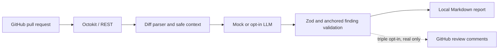

# AI Pull Request Reviewer

[](https://github.com/RamonRDR/ai-pull-request-reviewer/actions/workflows/ci.yml)
[](LICENSE)

**A security-first, human-in-the-loop pull request reviewer built with TypeScript, Octokit, GitHub Actions, Zod and pluggable LLM providers.**

**Languages:** English (primary) | [Português](README.pt-BR.md) | [Español](README.es.md)

> **Status: portfolio MVP, not a production security scanner.** The default provider is a clearly labeled deterministic **mock**; it does **not** find real bugs. Real LLM calls are opt-in, paid and not enabled in CI. Automated PR commenting is disabled by default.

## 1. Features

- Read PR metadata, base/head branches and changed files from GitHub REST API via Octokit pagination.
- Parse unified patches, locate added RIGHT-side lines, reject incomplete patches, recognize missing/binary files and report truncation.
- Exclude vendor, build, binary, lock and sensitive paths; redact common secrets before preparing model context.
- Prioritize source changes and enforce file, character, token and per-review dollar ceilings.
- Separate GitHub adapter, diff parser, context preparation, mock/OpenAI providers, validation, deduplication, Markdown reports and publication.
- Validate structured findings with Zod; filter hallucinated anchors, unwanted categories, low severities, duplicates and potentially sensitive output.
- Require **three explicit gates** to post real comments. Never approve, reject or merge PRs.
- Run unit/integration tests, a synthetic mock evaluation and a free demo in GitHub Actions.

## 2. Technology

Node.js 26 LTS in CI (Node >=22 supported by package configuration), TypeScript strict mode, @octokit/rest, OpenAI SDK adapter, Zod, Vitest, ESLint, Prettier and GitHub-hosted runners. No server, database, Redis or queues.

## 3. Architecture

See [architecture and data flow](docs/ARCHITECTURE.md) and [technical decisions](docs/DECISIONS.md).



PR code is **never checked out or executed by the reviewer**. Untrusted diff text is only data.

## 4. Installation

```bash
git clone https://github.com/RamonRDR/ai-pull-request-reviewer.git
cd ai-pull-request-reviewer
npm install
npm run typecheck
npm test
```

To run the zero-cost deterministic demonstration:

```bash
npm run demo
# open reports/demo.md
npm run evaluate
```

Mock fixtures contain `DEMO_BUG⟧, `DEMO_EDGE⟧ and similar markers; the mock provider intentionally reacts to these tags. The demonstration is **not evidence of general-purpose AI vulnerability detection**.

## 5. Configuration

Copy `.env.example⟧ into a local `.env⟧ only if you need credentials (the CLI does not auto-load .env). Set environment variables in your shell or a secure CI secret store. Never commit secrets. Adjust versioned rules in [`.ai-pr-reviewer.json⟧](.ai-pr-reviewer.json).

| Setting | Purpose |
| --- | --- |
| `categories⟧ | Enabled bug, security, edge_case, maintainability, testing and performance categories |
| `minSeverity⟧ | critical, high, medium, low or informational |
| `ignore⟧ | Extra file globs to exclude |
| `maxFiles⟧ / `maxContextChars⟧ | Input coverage and context caps |
| `maxInputTokens⟧ / `maxOutputTokens⟧ | Preflight estimate and model output limit |
| `maxCostUsd⟧ | Dollar ceiling per review, pre-checked against supplied provider prices |
| `maxComments⟧ | Maximum findings |
| `language⟧ / `customRules⟧ | Output language and repository-specific guidance |
| `enablePublishing⟧ | Must be `true⟧ for manual publishing, defaults to `false⟧ |

Invalid schemas fail before analysis.

## 6. GitHub API integration and live read-only usage

Use an appropriate fine-grained GitHub token with **Contents: read** and **Pull requests: read** access, scoped to your repository.

```bash
export GITHUB_TOKEN=YOUR_SCOPED_TOKEN
npm run build
node dist/src/cli.js --repo RamonRDR/ai-pull-request-reviewer --pr 1 --provider mock
# reports/review.md
```

The mock output for ordinary PRs is generally empty because it only responds to intentional synthetic markers. Reading a live PR with the mock provider does **not** imply it was reviewed by AI. Public PR metadata and diffs come from the official GitHub API, with API errors propagated without executing PR code. GitHub can truncate oversized patches or file collections; these omissions are disclosed.

## 7. Opt-in real LLM provider

This is an **optional, paid operation** and is never executed by mandatory CI:

```bash
export OPENAI_API_KEY=YOUR_KEY
export LLM_MODEL=gpt-4.1-mini
export LLM_INPUT_PRICE_PER_MILLION=YOUR_VERIFIED_INPUT_PRICE
export LLM_OUTPUT_PRICE_PER_MILLION=YOUR_VERIFIED_OUTPUT_PRICE
node dist/src/cli.js --repo OWNER/PUBLIC_REPO --pr 123 --provider openai --allow-external-llm
```

Verify prices from your provider account before running. The reviewer fails closed when prices, budget, token limit or API key are missing. Sending private repositories to an external LLM is prohibited by the CLI. Note that automated redaction is imperfect; do **not** analyze proprietary, confidential or secret-bearing code with a remote provider. Avoid putting token values in terminal history.

The adapter uses a system instruction that treats PR content as untrusted data, a versioned prompt in `src/provider.ts⟧, JSON-mode responses and Zod validation. Model outputs may be wrong. No provider claims of security accuracy are made.

## 8. Categories and severity

Categories: **bug**, **security**, **edge_case**, **maintainability**, **testing** and **performance**.

Severity: **critical**, **high**, **medium**, **low** and **informational**. Findings include file, added line, category, title, explanation, suggestion, severity and optional confidence/evidence. Confidence is not calibrated and cannot prove the issue exists.

## 9. Comments, deduplication and human approval

The default is report-only. Publishing is technically implemented but **not enabled**. It requires `--publish⟧, `enablePublishing: true⟧ and `ALLOW_GITHUB_COMMENTS=true⟧ simultaneously. A token with **Pull requests: write** permission would additionally be required. Forks, incomplete reviews and mock output cannot be published. Existing review comment fingerprints are queried to avoid duplicates. Only added RIGHT-side lines are accepted.

**No automatic APPROVE, REQUEST_CHANGES, merge or modifications to third-party repositories.** Enable publishing only after reviewing safety implications and explicitly authorizing it.

## 10. Security

Consult [threat model and limitations](docs/SECURITY.md). This tool does not check out PR head code, read PR secrets, execute scripts, or use `pull_request_target⟧. GitHub's `pull_request⟧ CI runs with read-only credentials, no AI keys and no publishing. Configuration should be versioned on a trusted base branch when used in privileged contexts.

## 11. Tests and GitHub Actions

```bash
npm run lint
npm run format:check
npm run typecheck
npm test
npm run test:integration
npm run evaluate
npm run build
```

[CI](.github/workflows/ci.yml) uses standard `ubuntu-latest⟧ runners to execute lint, formatting, strict TypeScript, Vitest, mock integration tests, synthetic evaluation, build, demo artifact upload and dependency audit. [Manual read-only review](.github/workflows/demo.yml) uses `workflow_dispatch⟧, with no expensive model calls. Neither workflow deploys or publishes PR reviews. GitHub Actions results must be checked on the PR before claiming a green build.

## 12. Evaluation

`npm run evaluate⟧ exercises **27 synthetic fixtures**: 18 marker-labeled positives across six categories, seven clean examples and two prompt-injection texts. It reports precision, recall, false-positive rate, duplicate rate, anchor validity, tokens and cost for the **deterministic mock oracle only**. These figures must not be cited as real LLM precision or security detection rates. The optional OpenAI adapter requires an independently collected evaluation dataset and real runs before performance claims.

## 13. Demonstration and sample output

See [demo procedure](docs/DEMO.md). The `reports/demo.md⟧ artifact is generated during CI, explicitly labeled simulated and references `src/average.ts⟧ with synthetic edge-case and logic findings. A second harmless fixture is left unflagged. Fingerprints are deterministic; duplicate filtering is tested separately. No screenshots or GIFs are asserted until actually generated.

## 14. Known limitations

- No clone or cross-file semantic graph; model sees permitted diff patches only.
- Missing, binary, deleted and large patches reduce coverage and must not be described as fully reviewed.
- A model may hallucinate or miss defects despite schema and line validation.
- Mock metrics measure marker recognition, not true vulnerability-detection quality.
- Provider cost is estimated, not guaranteed by the vendor; verify provider pricing and billing.
- Secret redaction and prompt-injection resistance are best-effort, not absolute.
- Publishing has not been authorized in a live PR; avoid assuming end-to-end write permissions are proven.
- No GitHub App installation or marketplace listing; GitHub-hosted CLI/Action is the MVP.

## 15. License

MIT, copyright © 2026 Ramon Rodriguez. See [LICENSE](LICENSE). Preserve third-party notices.

## 16. International portfolio scope

This project is designed to demonstrate API integration, constrained LLM orchestration, secure automation, software testing, evaluation literacy and developer tooling. **Humans remain responsible** for approvals, security decisions and merges.
