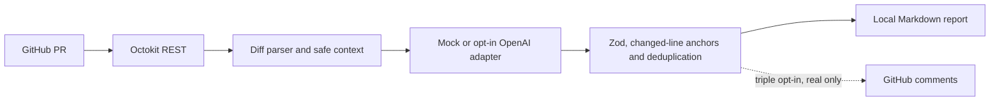

<div align="center">

# AI Pull Request Reviewer 🤖

**Revisões de PR seguras, orientações objetivas e decisões humanas.**

[🇺🇸 English](README.md) · [🇧🇷 Português](README.pt-BR.md) · [🇪🇸 Español](README.es.md)

[](https://github.com/RamonRDR/ai-pull-request-reviewer/actions/workflows/ci.yml)
[](https://nodejs.org/)
[](LICENSE)
[](README.md)

[](https://www.typescriptlang.org/)
[](https://github.com/octokit/rest.js)
[](https://docs.github.com/en/rest)
[](https://zod.dev/)
[](https://github.com/openai/openai-node)

[](src/cli.ts)
[](https://github.com/privatenumber/tsx)
[](.github/workflows/ci.yml)
[](.ai-pr-reviewer.json)

[](https://github.com/RamonRDR/ai-pull-request-reviewer/actions/runs/42421599236)
[](eslint.config.mjs)
[](.prettierrc.json)
[](tsconfig.json)
[](.github/workflows/ci.yml)
[](.github/workflows/ci.yml)
[](src/evaluate.ts)

</div>

> **Status do projeto:** MVP implementado no [PR #1](https://github.com/RamonRDR/ai-pull-request-reviewer/pull/1), ainda em **draft**. A [execução de CI confirmada](https://github.com/RamonRDR/ai-pull-request-reviewer/actions/runs/42421599236) passou com **26 testes Vitest (0 falhas, 0 ignorados)**, tipagem, lint, formatação, build, demonstração, avaliação simulada e auditoria das dependências de produção. Sem merge, análise com LLM real ou publicação de comentários autorizada.

## 1. Visão geral

Revisor de pull requests do GitHub com foco em segurança e decisão humana. Consulta alterações, prepara contexto com limites e produz observações técnicas em Markdown. É uma **CLI executável no GitHub Actions**, não um GitHub App hospedado. Não aprova, rejeita ou integra PRs automaticamente. **O mock padrão demonstra o fluxo com exemplos sintéticos; não detecta bugs reais** nem substitui um scanner de segurança.

## 2. Funcionalidades implementadas

- Consulta metadados de PR, branches de origem/destino e arquivos modificados via Octokit e GitHub REST, com paginação e tratamento de erros.
- Analisa diffs e identifica linhas adicionadas do lado RIGHT; ignora patches incompletos, binários, indisponíveis ou grandes, sem inventar localizações.
- Exclui dependências, arquivos gerados, lockfiles, binários e caminhos sensíveis; oculta padrões comuns de segredos antes de montar o contexto.
- Prioriza código-fonte e aplica limites de arquivos, caracteres, tokens, saída, comentários e custo estimado em dólares.
- Separa provedores: mock gratuito e determinístico, além de **adaptador opcional da API OpenAI, ainda sem validação completa ponta a ponta**.
- Valida JSON com Zod; filtra categorias, gravidades, duplicatas, saídas sensíveis e linhas sem correspondência no diff.
- Gera relatórios Markdown com ID, categoria, gravidade, localização, evidência, justificativa e sugestão de correção.
- Implementa publicação protegida por **três autorizações simultâneas**, bloqueando mocks, forks e análises parciais. Publicação real ainda não foi testada.

## 3. Stack tecnológica

**Ambiente:** Node.js **26 no CI** (mínimo declarado: `engines.node >=22`). **Linguagem:** TypeScript **5.9.3**, modo strict, e arquivos JavaScript de configuração. **Integração GitHub:** `@octokit/rest 22.0.1` e API REST. **Schemas:** Zod **4.6.7**. **IA opcional:** OpenAI SDK **6.49.0**, desativado sem autorização e orçamento. **Desenvolvimento:** `tsx 4.23.15`, Vitest **4.1.12**, ESLint **9.39.5**, Prettier **3.9.10**, npm e GitHub Actions. As versões específicas estão resolvidas no `package-lock.json`, com versões principais nos badges.

Não utiliza servidor, banco de dados, Redis, Docker, Python, pytest, E2E de navegador, RAG, embeddings, MCP nem pipeline de deploy.

## 4. Arquitetura



O sistema trata conteúdo de PR como **dados não confiáveis**, sem executar o código revisado. Consulte [arquitetura](docs/ARCHITECTURE.md), [decisões técnicas](docs/DECISIONS.md) e [modelo de ameaças](docs/SECURITY.md).

## 5. Pré-requisitos e instalação

Node.js **22 ou superior** e npm. O CI utiliza Node.js 26. Para PRs reais, configure token limitado ao repositório com **Contents: read** e **Pull requests: read**. A demonstração local dispensa tokens e serviços externos.

```bash
git clone https://github.com/RamonRDR/ai-pull-request-reviewer.git
cd ai-pull-request-reviewer
npm ci
npm run typecheck
npm test
npm run demo
npm run evaluate
```

A instalação utiliza o lockfile versionado. Nunca publique chaves nem tokens.

## 6. Configuração

As regras ficam em [`.ai-pr-reviewer.json`](.ai-pr-reviewer.json) e são validadas antes da análise.

| Configuração | Finalidade |
| --- | --- |
| `categories` / `minSeverity` | Categorias da revisão e gravidade mínima |
| `ignore` | Padrões glob adicionais para exclusão |
| `maxFiles` / `maxContextChars` | Escopo e limite de caracteres da entrada |
| `maxInputTokens` / `maxOutputTokens` | Estimativa inicial de entrada e limite da saída do modelo |
| `maxCostUsd` | Teto estimado do custo em USD por revisão |
| `maxComments` | Quantidade máxima de observações aceitas |
| `language` / `customRules` | Idioma do relatório e regras do repositório |
| `enablePublishing` | Desativado por padrão; requer outras autorizações |

Consulte [`.env.example`](.env.example). A CLI **não carrega arquivos .env automaticamente**; defina variáveis no ambiente ou gerenciador de segredos. O padrão é gerar somente relatórios.

## 7. CLI e uso da API GitHub

```bash
# Metadados de um PR real, em modo somente leitura e com provedor simulado:
export GITHUB_TOKEN=YOUR_SCOPED_TOKEN
npm run build
node dist/src/cli.js --repo OWNER/REPO --pr 123 --provider mock

# Exemplo offline (sem token, API paga ou PR real):
npm run demo
# Gerado: reports/demo.md
```

O modo `mock` consulta metadados reais, mas só reage a marcadores sintéticos intencionais, como `DEMO_BUG` e `DEMO_EDGE`. Um resultado vazio **não comprova que o PR está correto**.

## 8. LLM externo opcional e controle de custos

**Opcional e sujeito a cobrança:** utilize `--provider openai --allow-external-llm`. Confirme os preços atuais com o fornecedor, configure valores positivos por milhão de tokens e mantenha limites conservadores em `maxInputTokens`, `maxOutputTokens` e `maxCostUsd`.

```bash
export OPENAI_API_KEY=YOUR_KEY
export LLM_MODEL=gpt-4.1-mini
export LLM_INPUT_PRICE_PER_MILLION=YOUR_VERIFIED_INPUT_PRICE
export LLM_OUTPUT_PRICE_PER_MILLION=YOUR_VERIFIED_OUTPUT_PRICE
# Configure também GITHUB_TOKEN; utilize somente repositórios PÚBLICOS.
node dist/src/cli.js --repo OWNER/PUBLIC_REPO --pr 123 --provider openai --allow-external-llm
```

A CLI bloqueia modelos remotos em **repositórios privados**. A ocultação de segredos é limitada, então nunca envie código confidencial. Custos são estimativas, não garantias de faturamento. O CI obrigatório **não faz chamadas pagas**.

## 9. Observações, categorias e gravidade

Categorias: `bug`, `security`, `edge_case`, `maintainability`, `testing` e `performance`. Gravidades: `critical`, `high`, `medium`, `low` e `informational`. Cada achado refere-se a uma **linha adicionada existente**, tem identificador e correção sugerida, podendo incluir evidência e confiança não calibrada. O revisor não inventa comentários para preencher categorias; a validação final é humana.

## 10. Publicação e prevenção de duplicatas

Por padrão, a CLI produz apenas um relatório Markdown local. Para publicar, são necessários `--publish`, `enablePublishing: true` e `ALLOW_GITHUB_COMMENTS=true` **simultaneamente**, além de **Pull requests: write**. A publicação rejeita mocks, forks e revisões parciais, além de verificar fingerprints de comentários anteriores. Usa somente o evento `COMMENT`, nunca `APPROVE`, `REQUEST_CHANGES` ou merge. **A publicação real permanece desativada e não validada em PRs externos.**

## 11. Testes, qualidade e GitHub Actions

```bash
npm run lint
npm run format:check
npm run typecheck
npm test
npm run test:integration
npm run evaluate
npm run build
```

O [CI](.github/workflows/ci.yml) executa `npm ci`, ESLint, Prettier, TypeScript strict, Vitest, avaliação sintética, build, upload do relatório demonstrativo e auditoria de dependências de produção em runners do GitHub. O [workflow manual somente leitura](.github/workflows/demo.yml) recebe um número opcional de PR e não publica comentários. Não há runner self-hosted, deploy ou uso de IA paga.

**Check de referência confirmado:** [26 aprovados, 0 falhas, 0 ignorados](https://github.com/RamonRDR/ai-pull-request-reviewer/actions/runs/42421599236). O badge usa a **contagem real confirmada**, não estimativa por arquivos. O CI compara os badges dos três READMEs ao relatório JSON do Vitest; se a quantidade mudar, atualize todos os badges para o check passar. Não é anunciada porcentagem de cobertura, pois não há medição.

## 12. Metodologia de avaliação

`npm run evaluate` usa **27 cenários sintéticos**: 18 marcadores em seis categorias, 7 mudanças sem falhas e 2 textos de prompt injection. As métricas incluem precisão, recall, falsos positivos, duplicatas, localização, tokens e custo **somente do mock**. **Não demonstram eficácia da OpenAI ou detecção real de vulnerabilidades.** O modelo real não foi avaliado.

## 13. Segurança

Leia [SECURITY.md](docs/SECURITY.md). Os controles incluem permissões de leitura no GitHub Actions, exclusão de arquivos sensíveis, redação parcial de segredos, orçamento, isolamento de diffs não confiáveis, Zod, conferência de linhas, bloqueio de publicação em forks e autorização tripla. O revisor não faz checkout nem executa código de PRs de terceiros e não usa `pull_request_target`. Prompt injection, segredos incomuns e alucinações são riscos residuais.

## 14. Demonstração reproduzível

Execute `npm run demo` para gerar `reports/demo.md` com o aviso **SIMULATED DEMO ONLY**. O exemplo `src/average.ts` contém marcadores artificiais de lógica e entrada vazia; `src/greeting.ts` não deve gerar observação. Consulte o [guia da demonstração](docs/DEMO.md) e o [relatório ilustrativo](examples/review.sample.md). O CI disponibiliza o arquivo como artefato. Não há alegação de vídeos, screenshots ou revisões reais.

## 15. Estrutura do projeto

| Caminho | Responsabilidade |
| --- | --- |
| `src/github.ts` / `src/diff.ts` | Octokit REST, paginação e interpretação das linhas alteradas |
| `src/context.ts` / `src/config.ts` | Filtros, redação de segredos, limites e regras validadas |
| `src/provider.ts` | Mock determinístico e adaptador OpenAI opcional |
| `src/models.ts` / `src/review.ts` | Schemas, gravidade, localização e deduplicação |
| `src/report.ts` / `src/publish.ts` | Relatório Markdown e comentários protegidos |
| `src/cli.ts` / `src/demo.ts` / `src/evaluate.ts` | Comandos, demonstração local e avaliação sintética |
| `tests/` | Testes unitários e testes de integração simulados com Vitest |
| `.github/workflows/ci.yml` | Qualidade, avaliação, build, auditoria e relatório de demonstração |
| `.github/workflows/demo.yml` | Revisão manual somente leitura |
| `docs/` / `examples/` | Arquitetura, ADRs, segurança, demonstração e exemplos |

## 16. Limitações conhecidas

- Sem análise semântica completa entre arquivos, execução do código revisado, precisão comprovada de LLM ou GitHub App instalado em produção.
- Patches binários, grandes ou ausentes reduzem cobertura; o relatório informa análises parciais.
- Modelos podem inventar ou deixar passar problemas, mesmo após validação de schema e linhas.
- Proteção contra prompt injection, ocultação de segredos e estimativa de custos **não são garantias**.
- Chamadas a LLM real e publicação de comentários reais ainda não foram autorizadas nem testadas ponta a ponta.
- O projeto não publica pacotes npm nem faz deploy.

## 17. Contribuição e manutenção

Abra uma issue antes de mudanças extensas; envie PRs pequenos, acompanhados de testes e atualizações da documentação em inglês. Mantenha português e espanhol alinhados. Execute `npm run check` antes do merge. A contagem de testes nos badges deve coincidir com a última execução bem-sucedida e é conferida por `scripts/check-test-badges.mjs`. Aprovações e merges permanecem decisões humanas.

## 18. Licença

[MIT](LICENSE) © 2026 Ramon Rodriguez. Preserve os avisos de terceiros.
