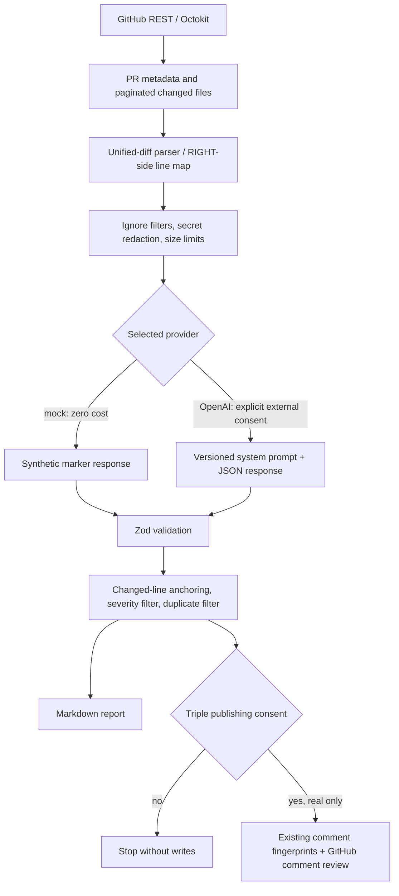

# Architecture (MVP)

## Module boundaries

| Module | Responsibility |
| --- | --- |
| `github.ts⟧ | REST authentication, PR metadata and pagination |
| `diff.ts⟧ | RIGHT-side added-line tracking |
| `context.ts⟧ | Ignore rules, source prioritization, safety filtering, limits |
| `config.ts⟧ | Strict repository configuration schema |
| `provider.ts⟧ | Mock and opt-in OpenAI adapters, cost and response validation |
| `review.ts⟧ | Quality gates, anchors, classifications and deduplication |
| `report.ts⟧ | Human-readable, clearly labeled Markdown |
| `publish.ts⟧ | Separately gated, deduplicated review comments |
| `cli.ts⟧ | Explicit CLI orchestration |
| `evaluate.ts⟧ | Synthetic, deterministic regression metrics |

An external GitHub App with webhook infrastructure is intentionally not used. Source code from PR heads is never evaluated inside the reviewer. Review results are advisory.
